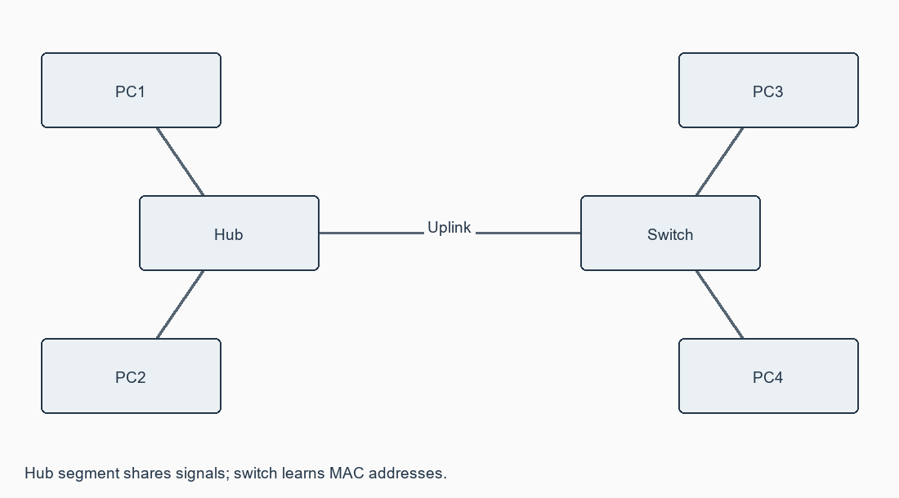
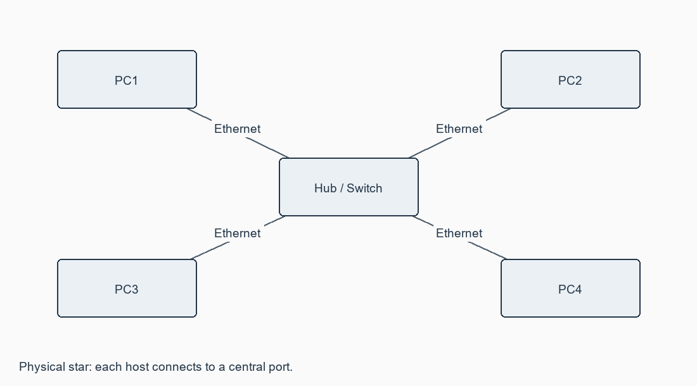

# Exercise 03: Experiments on CISCO PACKET TRACER (Simulation Tool)

**[Open this exercise record PDF](CN_Exercise_03.pdf)**

## Aim

To understand Packet Tracer, design simple networks and analyse hub and switch behaviour.

## Requirements

Cisco Packet Tracer; four to six PCs; Hub-PT; 2960 switch; Ethernet connections.

## Procedure / algorithm

1. Install/open Packet Tracer. Identify the device-selection box, Logical/Physical workspace, common tools, Realtime/Simulation tabs and event/PDU list.
2. Create four PCs and a hub. Connect each host to a hub port using copper straight-through cables.
3. Assign the unique 192.168.1.1-4/24 addresses in addressing.csv. No default gateway is needed within this single subnet.
4. Send a Simple PDU between hosts. In Simulation mode inspect ARP and ICMP events and the ports receiving the repeated traffic.
5. Build the same network with a switch and repeat. Inspect show mac address-table before and after communication.
6. Build the mixed topology with two PCs on the hub and two on the switch; use an uplink or automatic cable choice for the hub-switch connection.
7. Compare forwarding and collision domains. Inspect the actual college network and draw its observed labelled topology separately.

## Complete source / configuration files

### [addressing.csv](addressing.csv)

```text

device,ip,mask,gateway
PC1,192.168.1.1,255.255.255.0,none
PC2,192.168.1.2,255.255.255.0,none
PC3,192.168.1.3,255.255.255.0,none
PC4,192.168.1.4,255.255.255.0,none

```

### [switch.cfg](switch.cfg)

```text

enable
configure terminal
hostname SW1
interface range FastEthernet0/1-4
 switchport mode access
 no shutdown
end
show mac address-table
show interfaces status

```

## Diagrams





## Actual output / verification

Not executed in the required lab/tool environment. No actual operational output is claimed.

## Expected output

All four assigned hosts communicate. Hub-connected hosts see repeated signals; switch unicast forwarding becomes selective after MAC learning. ARP broadcasts are flooded.

## Observations

A hub repeats signals to all other ports and has one shared collision domain. A switch learns source MAC-to-port mappings and forwards known unicast to the required port. Broadcasts and unknown unicast are flooded within the VLAN. An actual college topology is not invented.

## Result

Hub-only, switch-only and combined designs, addresses and switch commands are supplied. Packet Tracer execution and campus inspection remain pending.
