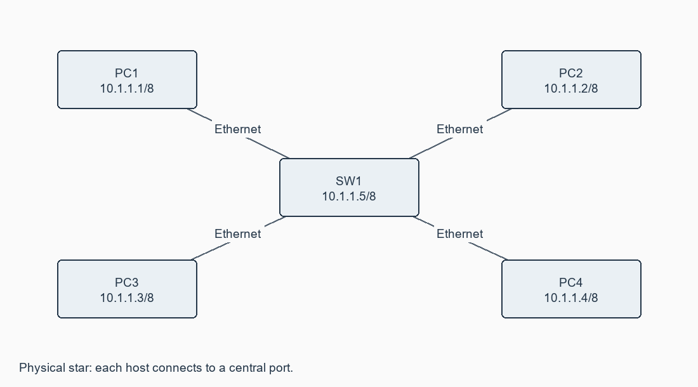

# Exercise 04: Setup and configure a LAN (Local area network) using a Switch and Ethernet cables in your lab

**[Open this exercise record PDF](CN_Exercise_04.pdf)**

## Aim

To connect 3-4 host machines through a switch, assign IP addresses, verify ping and share files across the LAN.

## Requirements

Four Ethernet PCs, a switch and four straight-through cables; Windows sharing permissions.

## Procedure / algorithm

1. Plan a star topology; connect each PC to a separate switch port and verify link indicators.
2. Open Ethernet Properties > IPv4 and assign addressing.csv values: PC1-4 = 10.1.1.1-4, mask 255.0.0.0.
3. If the switch is managed, configure management SVI 10.1.1.5/8 using switch.cfg. An unmanaged switch needs no management address.
4. Run ping between hosts in both directions and to the managed switch. Inspect ipconfig /all and arp -a.
5. Enable network discovery and file sharing on the lab network. Share a test folder on PC1 with the required users.
6. From another PC, open the UNC path, copy a test file and verify its content. Sharing and file-system permissions must both allow access.

## Complete source / configuration files

### [addressing.csv](addressing.csv)

```text

device,ip,mask
PC1,10.1.1.1,255.0.0.0
PC2,10.1.1.2,255.0.0.0
PC3,10.1.1.3,255.0.0.0
PC4,10.1.1.4,255.0.0.0
SW1-management,10.1.1.5,255.0.0.0

```

### [connectivity_and_sharing.txt](connectivity_and_sharing.txt)

```text

Set each PC IPv4 address/mask using Ethernet Properties; no gateway needed in the isolated LAN.
ipconfig /all
ping 10.1.1.2
ping 10.1.1.3
ping 10.1.1.4
ping 10.1.1.5
arp -a
Enable network discovery/file sharing on the lab network.
On PC1: folder Properties > Sharing > share with assigned users.
Set sharing and file-system permissions. From PC2 open:
\\10.1.1.1\SharedFolder
Copy a test file and compare its contents.

```

### [switch.cfg](switch.cfg)

```text

enable
configure terminal
hostname SW1
interface range FastEthernet0/1-4
 switchport mode access
 no shutdown
 exit
interface vlan 1
 ip address 10.1.1.5 255.0.0.0
 no shutdown
end
show ip interface brief
copy running-config startup-config

```

## Diagrams



## Actual output / verification

Not executed in the required lab/tool environment. No actual operational output is claimed.

## Expected output

Pings return replies from each host; ARP lists their MAC addresses. The shared file can be read/copied from another PC. Wrong masks, duplicate addresses, cabling or permissions can cause failure.

## Observations

All isolated-LAN hosts share one /8 network and require unique addresses; a local gateway is unnecessary. A management IP administers the switch and is not required for basic frame forwarding.

## Result

The LAN design, address plan, switch configuration and sharing checks are complete. Physical LAN/file-sharing tests have not been run here.
