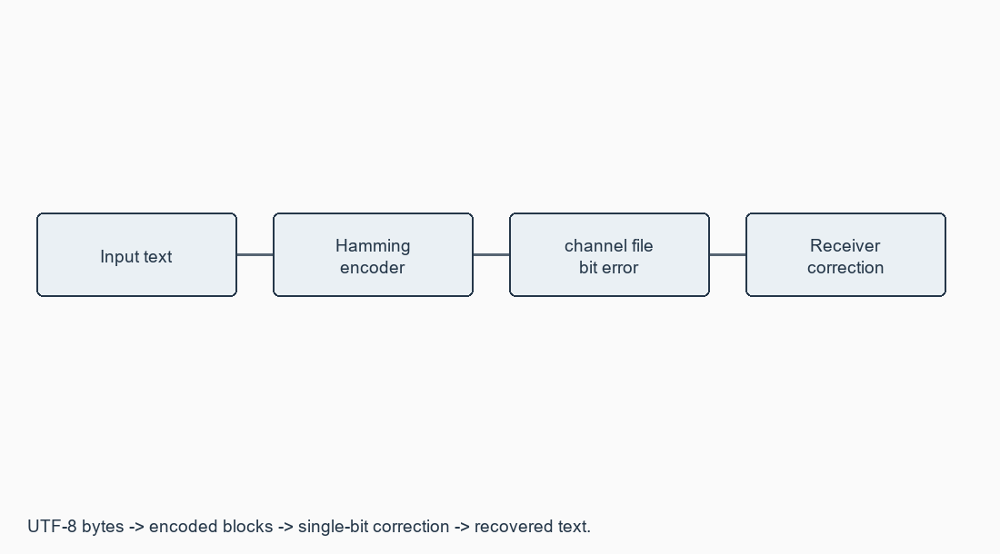

# Exercise 06: Error Correction at Data Link Layer

**[Open this exercise record PDF](CN_Exercise_06.pdf)**

## Aim

To implement Hamming-code error detection and correction, input a data stream and verify error correction.

## Requirements

Python 3.10+; sender/receiver modes; channel file.

## Procedure / algorithm

1. Read input text of arbitrary length and convert its UTF-8 bytes to binary.
2. Use Hamming (12,8) for each byte; put parity at positions 1,2,4,8. The relation is 2^r >= m+r+1.
3. Set even parity for each group and write complete encoded blocks to channel.
4. Change a chosen bit in a chosen block using flip mode.
5. Read channel in receive mode, calculate the syndrome, report/correct a single-bit error, remove parity and recover UTF-8 text.
6. Test no error, one-bit error, empty/Unicode text and malformed blocks. Do not claim reliable multi-bit correction.

## Complete source / configuration files

### [hamming.py](hamming.py)

```python

"""Bytewise Hamming (12,8), even parity; corrects one bit per block."""
import argparse
from pathlib import Path

PARITY = (1, 2, 4, 8)


def encode_byte(value):
    if not 0 <= value <= 255:
        raise ValueError("A byte must be between 0 and 255")
    bits = iter(f"{value:08b}")
    frame = [0] * 13
    for i in range(1, 13):
        if i not in PARITY:
            frame[i] = int(next(bits))
    for k in PARITY:
        frame[k] = sum(frame[i] for i in range(1, 13) if i & k) % 2
    return "".join(map(str, frame[1:]))


def decode_block(block):
    if len(block) != 12 or set(block) - {"0", "1"}:
        raise ValueError("Each block must contain exactly 12 binary digits")
    frame = [0] + list(map(int, block))
    syndrome = sum(k for k in PARITY
                   if sum(frame[i] for i in range(1, 13) if i & k) % 2)
    if syndrome > 12:
        raise ValueError("Invalid syndrome; possible multiple-bit error")
    if syndrome:
        frame[syndrome] ^= 1
    bits = "".join(str(frame[i]) for i in range(1, 13) if i not in PARITY)
    return int(bits, 2), syndrome


def send(text, channel):
    blocks = [encode_byte(b) for b in text.encode("utf-8")]
    Path(channel).write_text("\n".join(blocks), encoding="ascii")
    return blocks


def receive(channel):
    decoded = [decode_block(b) for b in Path(channel).read_text().split()]
    text = bytes(b for b, _ in decoded).decode("utf-8")
    return text, [s for _, s in decoded]


def flip(channel, block_number, position):
    blocks = Path(channel).read_text().split()
    if not 1 <= block_number <= len(blocks) or not 1 <= position <= 12:
        raise ValueError("Block and bit positions are 1-based and must exist")
    bits = list(blocks[block_number - 1])
    bits[position - 1] = str(1 - int(bits[position - 1]))
    blocks[block_number - 1] = "".join(bits)
    Path(channel).write_text("\n".join(blocks), encoding="ascii")


def main():
    parser = argparse.ArgumentParser(description=__doc__)
    parser.add_argument("mode", choices=["send", "receive", "flip", "demo"])
    parser.add_argument("--text", default="A")
    parser.add_argument("--channel", default="channel")
    parser.add_argument("--block", type=int, default=1)
    parser.add_argument("--bit", type=int, default=6)
    args = parser.parse_args()
    if args.mode in ("send", "demo"):
        print("Input:", args.text)
        print("Encoded:", " ".join(send(args.text, args.channel)))
    if args.mode in ("flip", "demo"):
        flip(args.channel, args.block, args.bit)
        print("Corrupted:", " ".join(Path(args.channel).read_text().split()))
    if args.mode in ("receive", "demo"):
        text, positions = receive(args.channel)
        print("Error positions:", positions)
        print("Recovered:", text)
    print("Limit: one corrected bit per block; multiple errors may miscorrect.")


if __name__ == "__main__":
    main()

```

## Diagrams



## Run

Commands are from the repository root unless a cd command is shown.

```text

python Exercise_06/hamming.py send --text "Computer Networks" --channel channel
python Exercise_06/hamming.py flip --channel channel --block 1 --bit 6
python Exercise_06/hamming.py receive --channel channel
python Exercise_06/hamming.py demo --text A --channel channel

```

## Actual output / verification

```text

ACTUAL PROGRAM RUN
Input: A
Encoded: 100010010001
Corrupted: 100011010001
Error positions: [6]
Recovered: A
Limit: one corrected bit per block; multiple errors may miscorrect.

```

## Expected output

For input A: encoded 100010010001; after bit 6 changes, 100011010001; syndrome 6; recovered A.

## Observations

The implementation was run with input A and bit 6 changed. Tests covered all 256 byte values and all 12 single-bit positions: 3,072 correction cases. Ordinary Hamming does not reliably detect/distinguish all multi-bit errors.

## Result

Hamming encoding, single-bit correction and text recovery were executed and verified.
