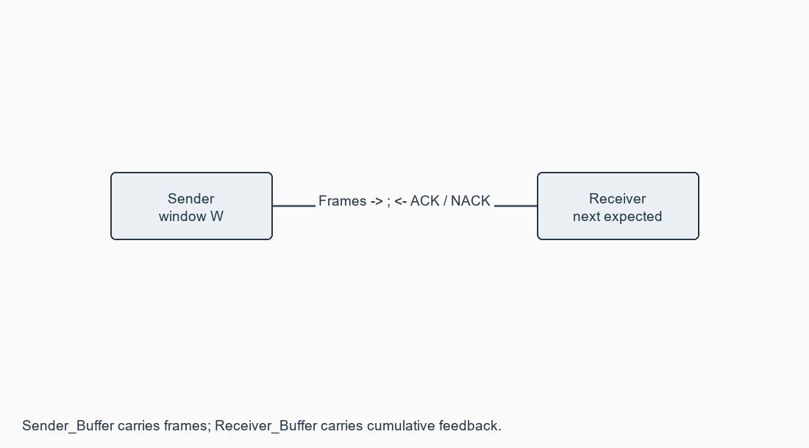

# Exercise 07: Flow control at Data Link Layer

**[Open this exercise record PDF](CN_Exercise_07.pdf)**

## Aim

To implement sliding-window flow control and simulate frames flowing from one node to another.

## Requirements

Python 3.10+; Sender_Buffer and Receiver_Buffer files.

## Procedure / algorithm

1. Read window size W and a text message. Treat each character as one numbered frame [number, DATA].
2. Write/print the current window into Sender_Buffer. Introduce delay or manual pause before processing feedback.
3. The receiver reads Sender_Buffer, accepts in-order frames, discards duplicates and writes ACK next_expected or NACK missing_number to Receiver_Buffer.
4. The sender reads the feedback. Advance on a valid ACK; on NACK resend from the indicated frame. On timeout or invalid ACK, resend without incorrectly advancing.
5. Overwrite buffers for each new window. During manual mode, edit a frame/ACK number to verify behaviour.
6. Use built-in injections for an incorrect frame, discarded feedback (timeout) and an out-of-window ACK. Piggybacking is an optional extension, not claimed in this one-way simulation.

## Complete source / configuration files

### [sliding_window.py](sliding_window.py)

```python

"""File-buffer Go-Back-N style sliding-window demonstration."""
import argparse
import json
import time
from pathlib import Path


def write_json(path, data):
    Path(path).write_text(json.dumps(data, indent=2), encoding="utf-8")


def receiver(frames, expected, output):
    for frame in frames:
        number = frame["number"]
        if number < expected:
            continue  # An accepted retransmission must not duplicate the text.
        if number != expected:
            return {"kind": "NACK", "next": expected}, expected, output
        output += frame["data"]
        expected += 1
    return {"kind": "ACK", "next": expected}, expected, output


def simulate(message, window=3, directory=".", error_at=None,
             bad_ack_once=False, timeout_once=False, delay=0, manual=False):
    if window <= 0:
        raise ValueError("Window size must be positive")
    if error_at is not None and not 0 <= error_at < len(message):
        raise ValueError("Error frame must exist")
    directory = Path(directory)
    directory.mkdir(parents=True, exist_ok=True)
    sender_file = directory / "Sender_Buffer"
    receiver_file = directory / "Receiver_Buffer"
    base = expected = attempts = 0
    output = ""
    injected = ack_injected = timed_out = False
    events = []
    while base < len(message):
        attempts += 1
        if attempts > max(20, len(message) * 5):
            raise RuntimeError("No progress: check manually edited buffer files")
        end = min(base + window, len(message))
        frames = [{"number": i, "data": message[i]} for i in range(base, end)]
        write_json(sender_file, frames)
        events.append("SEND " + json.dumps(frames))
        if error_at is not None and not injected and base <= error_at < end:
            frames[error_at - base]["number"] += 100
            write_json(sender_file, frames)
            events.append(f"INJECT incorrect number at frame {error_at}")
            injected = True
        if manual:
            input("Edit Sender_Buffer now, then press Enter: ")
        time.sleep(delay)
        frames = json.loads(sender_file.read_text())
        ack, expected, output = receiver(frames, expected, output)
        write_json(receiver_file, ack)
        events.append(f"RECEIVER {ack['kind']} {ack['next']}")
        if timeout_once and not timed_out:
            events.append("TIMEOUT: feedback discarded; resend current window")
            timed_out = True
            continue
        if bad_ack_once and not ack_injected:
            write_json(receiver_file, {"kind": "ACK", "next": end + 100})
            ack_injected = True
        if manual:
            input("Edit Receiver_Buffer now, then press Enter: ")
        ack = json.loads(receiver_file.read_text())
        k = ack.get("next")
        valid = isinstance(k, int) and (
            ack.get("kind") == "ACK" and base < k <= end or
            ack.get("kind") == "NACK" and base <= k < end)
        if not valid:
            events.append("INVALID feedback: resend current window")
            continue
        events.append(f"{ack['kind']} {k}")
        base = k
    return output, events


def main():
    p = argparse.ArgumentParser(description=__doc__)
    p.add_argument("--text", default="NETWORK")
    p.add_argument("--window", type=int, default=3)
    p.add_argument("--directory", default=".")
    p.add_argument("--error-at", type=int)
    p.add_argument("--bad-ack-once", action="store_true")
    p.add_argument("--timeout-once", action="store_true")
    p.add_argument("--delay", type=float, default=0)
    p.add_argument("--manual", action="store_true")
    a = p.parse_args()
    output, events = simulate(a.text, a.window, a.directory, a.error_at,
                             a.bad_ack_once, a.timeout_once, a.delay, a.manual)
    print("\n".join(events))
    print("Recovered:", output)


if __name__ == "__main__":
    main()

```

## Diagrams



## Run

Commands are from the repository root unless a cd command is shown.

```text

python Exercise_07/sliding_window.py --text NETWORK --window 3
python Exercise_07/sliding_window.py --text NETWORK --window 3 --error-at 4 --bad-ack-once --timeout-once
python Exercise_07/sliding_window.py --text NETWORK --window 3 --manual --delay 1

```

## Actual output / verification

```text

ACTUAL PROGRAM RUN
SEND [{"number": 0, "data": "N"}, {"number": 1, "data": "E"}, {"number": 2, "data": "T"}]
RECEIVER ACK 3
TIMEOUT: feedback discarded; resend current window
SEND [{"number": 0, "data": "N"}, {"number": 1, "data": "E"}, {"number": 2, "data": "T"}]
RECEIVER ACK 3
INVALID feedback: resend current window
SEND [{"number": 0, "data": "N"}, {"number": 1, "data": "E"}, {"number": 2, "data": "T"}]
RECEIVER ACK 3
ACK 3
SEND [{"number": 3, "data": "W"}, {"number": 4, "data": "O"}, {"number": 5, "data": "R"}]
INJECT incorrect number at frame 4
RECEIVER NACK 4
NACK 4
SEND [{"number": 4, "data": "O"}, {"number": 5, "data": "R"}, {"number": 6, "data": "K"}]
RECEIVER ACK 7
ACK 7
Recovered: NETWORK

```

## Expected output

Without errors: frames 0-2 -> ACK 3; 3-5 -> ACK 6; 6 -> ACK 7. An incorrect frame 4 generates NACK 4 followed by retransmission.

## Observations

This is a file-buffer Go-Back-N style simulation, not a hardware link protocol. The live program recovered NETWORK after timeout, invalid ACK and NACK 4. Tests exercised windows 1,3,20, empty input and invalid sizes.

## Result

Window advancement, timeout/invalid-ACK handling and retransmission were executed and verified using the specified buffer files.
