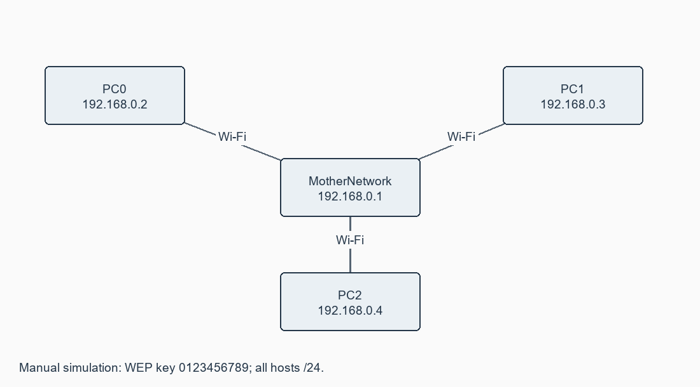

# Exercise 08: NMAP to Discover Live Hosts Using Nmap Scans (ARP, ICMP, TCP/UDP) on the TryHackMe Platform

**[Open this exercise record PDF](CN_Exercise_08.pdf)**

## Aim

To discover live hosts using Nmap ARP, ICMP and TCP/UDP scans; additionally configure the manual's wireless LAN.

## Requirements

TryHackMe Nmap Live Host Discovery room and assigned target; Nmap; Packet Tracer for wireless Part B.

## Procedure / algorithm

1. Start the TryHackMe lab machine and AttackBox or approved VPN machine. Identify the assigned target/subnet.
2. Preview targets using -sL -n; supply a host, range, CIDR block or -iL list. For 10.10.12.13/29 the block contains addresses .8-.15.
3. Run ARP discovery (-PR -sn) for local Ethernet hosts. Compare ICMP Echo (-PE), Timestamp (-PP) and Mask (-PM) discovery.
4. Run TCP SYN (-PS), TCP ACK (-PA) and UDP (-PU) discovery. Use --disable-arp-ping to compare IP probes on a local link.
5. Observe SYN/ACK or RST for SYN probes; RST for ACK probes; UDP response or ICMP port unreachable for UDP probes. No response is inconclusive.
6. Part B: add three wireless PCs and a Linksys router. Configure MotherNetwork, LAN 192.168.0.1/24 and static PC .2,.3,.4 with .1 gateway.
7. Reproduce legacy WEP key 0123456789 only in the manual simulation. Join the SSID with matching settings and test router/peer pings.

## Complete source / configuration files

### [nmap_commands.sh](nmap_commands.sh)

```text

#!/usr/bin/env bash
set -euo pipefail
TARGETS="${1:?Supply the assigned TryHackMe target or subnet}"
nmap -sL -n "$TARGETS"
sudo nmap -sn -PR "$TARGETS"
sudo nmap -sn -PE --disable-arp-ping "$TARGETS"
sudo nmap -sn -PP --disable-arp-ping "$TARGETS"
sudo nmap -sn -PM --disable-arp-ping "$TARGETS"
sudo nmap -sn -PS80,443 --disable-arp-ping "$TARGETS"
sudo nmap -sn -PA80 --disable-arp-ping "$TARGETS"
sudo nmap -sn -PU40125 --disable-arp-ping "$TARGETS"
# Other target forms: -iL list_of_hosts.txt, an IP range, or CIDR subnet.
# -n skips DNS; -R requests all reverse lookups; --dns-servers selects DNS.

```

### [wireless_config.txt](wireless_config.txt)

```text

Router LAN 192.168.0.1/24; SSID MotherNetwork.
Manual simulation security: WEP; Key1 0123456789.
Administration credentials in manual simulation: admin/admin.
PC0 192.168.0.2; PC1 192.168.0.3; PC2 192.168.0.4.
All masks 255.255.255.0; gateway 192.168.0.1.
Install wireless adapters while devices are powered off; PC Wireless > Connect > Refresh > MotherNetwork > enter key.
Use WPA2/WPA3 and unique credentials on physical equipment; WEP is legacy.
Ping router and peer; save the topology.

```

## Diagrams



## Actual output / verification

Not executed in the required lab/tool environment. No actual operational output is claimed.

## Expected output

Nmap reports responsive target addresses as Host is up and gives a live-host count. Wireless PCs associate to MotherNetwork and ping the router/peers. Real WLANs should use WPA2/WPA3, not WEP.

## Observations

ARP only discovers local-link hosts; IP discovery can be filtered. TCP SYN supports an unprivileged connect method; crafted ACK discovery requires privileges. -n skips DNS and -R requests reverse lookup for all targets. No TryHackMe scan or wireless simulation was executed here.

## Result

All required discovery commands and Part B wireless settings are supplied; live scans and WLAN execution are pending.
