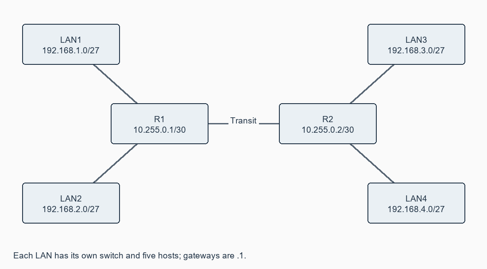

# Exercise 09: Implementation of SUBNETTING in CISCO PACKET TRACER simulator

**[Open this exercise record PDF](CN_Exercise_09.pdf)**

## Aim

To design multiple subnets, assign static IP addresses, connect them through routers and compare connectivity with/without routing.

## Requirements

Packet Tracer; two 2911 routers (three Gigabit interfaces each), four access switches and five hosts per LAN.

## Procedure / algorithm

1. Calculate /27 from a /24: borrow three bits; obtain eight subnets, block size 32 and 30 usable hosts. Network/broadcast addresses are not host addresses.
2. Build four separate LANs 192.168.1.0/27 through 192.168.4.0/27, as in the manual's address examples. Each has a separate switch.
3. Assign host addresses .11-.15, /27 masks and gateway .1 from addressing.csv. R1 serves LANs 1/2 and R2 serves LANs 3/4.
4. Connect R1/R2 through the added 10.255.0.0/30 transit link. Apply both router configurations, including reciprocal remote-LAN static routes.
5. Apply access-port switch configuration to each LAN switch. Do not assign network IDs to physical Layer 2 switch ports.
6. Ping within a LAN, between the two LANs on one router and across the transit link. Inspect the routing table and packet simulation.
7. Disable the relevant router/transit link and compare failed inter-subnet communication with continuing same-subnet communication.

## Complete source / configuration files

### [addressing.csv](addressing.csv)

```text

device,interface,ip,prefix,gateway
R1,GigabitEthernet0/0,192.168.1.1,27,none
LAN1-PC1,FastEthernet0,192.168.1.11,27,192.168.1.1
LAN1-PC2,FastEthernet0,192.168.1.12,27,192.168.1.1
LAN1-PC3,FastEthernet0,192.168.1.13,27,192.168.1.1
LAN1-PC4,FastEthernet0,192.168.1.14,27,192.168.1.1
LAN1-PC5,FastEthernet0,192.168.1.15,27,192.168.1.1
R1,GigabitEthernet0/1,192.168.2.1,27,none
LAN2-PC1,FastEthernet0,192.168.2.11,27,192.168.2.1
LAN2-PC2,FastEthernet0,192.168.2.12,27,192.168.2.1
LAN2-PC3,FastEthernet0,192.168.2.13,27,192.168.2.1
LAN2-PC4,FastEthernet0,192.168.2.14,27,192.168.2.1
LAN2-PC5,FastEthernet0,192.168.2.15,27,192.168.2.1
R1,GigabitEthernet0/2,10.255.0.1,30,none
R2,GigabitEthernet0/0,192.168.3.1,27,none
LAN3-PC1,FastEthernet0,192.168.3.11,27,192.168.3.1
LAN3-PC2,FastEthernet0,192.168.3.12,27,192.168.3.1
LAN3-PC3,FastEthernet0,192.168.3.13,27,192.168.3.1
LAN3-PC4,FastEthernet0,192.168.3.14,27,192.168.3.1
LAN3-PC5,FastEthernet0,192.168.3.15,27,192.168.3.1
R2,GigabitEthernet0/1,192.168.4.1,27,none
LAN4-PC1,FastEthernet0,192.168.4.11,27,192.168.4.1
LAN4-PC2,FastEthernet0,192.168.4.12,27,192.168.4.1
LAN4-PC3,FastEthernet0,192.168.4.13,27,192.168.4.1
LAN4-PC4,FastEthernet0,192.168.4.14,27,192.168.4.1
LAN4-PC5,FastEthernet0,192.168.4.15,27,192.168.4.1
R2,GigabitEthernet0/2,10.255.0.2,30,none

```

### [R1.cfg](R1.cfg)

```text

enable
configure terminal
hostname R1
interface GigabitEthernet0/0
 ip address 192.168.1.1 255.255.255.224
 no shutdown
 exit
interface GigabitEthernet0/1
 ip address 192.168.2.1 255.255.255.224
 no shutdown
 exit
interface GigabitEthernet0/2
 ip address 10.255.0.1 255.255.255.252
 no shutdown
 exit
ip route 192.168.3.0 255.255.255.224 10.255.0.2
ip route 192.168.4.0 255.255.255.224 10.255.0.2
end
copy running-config startup-config

```

### [R2.cfg](R2.cfg)

```text

enable
configure terminal
hostname R2
interface GigabitEthernet0/0
 ip address 192.168.3.1 255.255.255.224
 no shutdown
 exit
interface GigabitEthernet0/1
 ip address 192.168.4.1 255.255.255.224
 no shutdown
 exit
interface GigabitEthernet0/2
 ip address 10.255.0.2 255.255.255.252
 no shutdown
 exit
ip route 192.168.1.0 255.255.255.224 10.255.0.1
ip route 192.168.2.0 255.255.255.224 10.255.0.1
end
copy running-config startup-config

```

### [switch.cfg](switch.cfg)

```text

enable
configure terminal
interface range FastEthernet0/1-6
 switchport mode access
 no shutdown
end
copy running-config startup-config

```

## Diagrams



## Actual output / verification

Not executed in the required lab/tool environment. No actual operational output is claimed.

## Expected output

Same-subnet traffic works through the switch. Inter-subnet traffic requires reachable gateways/routes. Removing routing breaks inter-subnet traffic but not local traffic.

## Observations

The manual mixes a /24-to-/27 calculation with LANs from four different /24 blocks; this submission explicitly distinguishes them. Separate switches avoid unintended shared broadcast domains. The transit link/routes complete cross-router connectivity that the manual omits.

## Result

A complete four-subnet configuration is supplied and address plans are checked offline; Packet Tracer connectivity remains pending.
