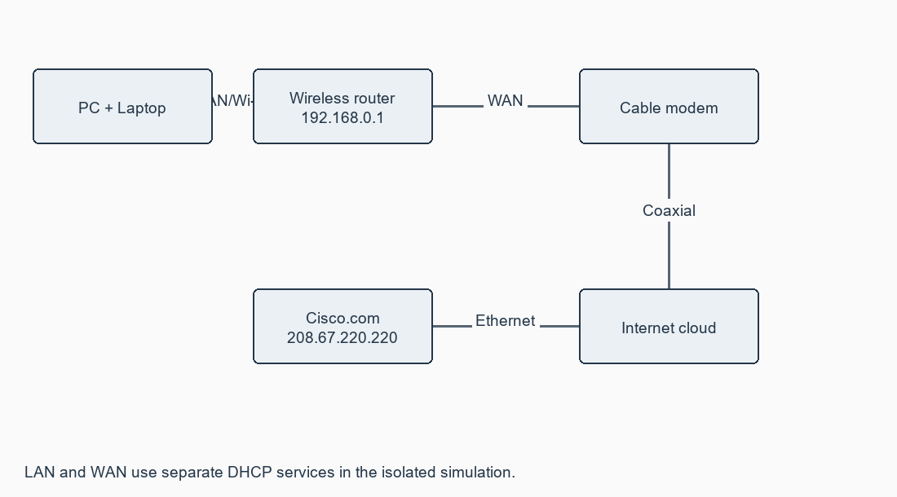
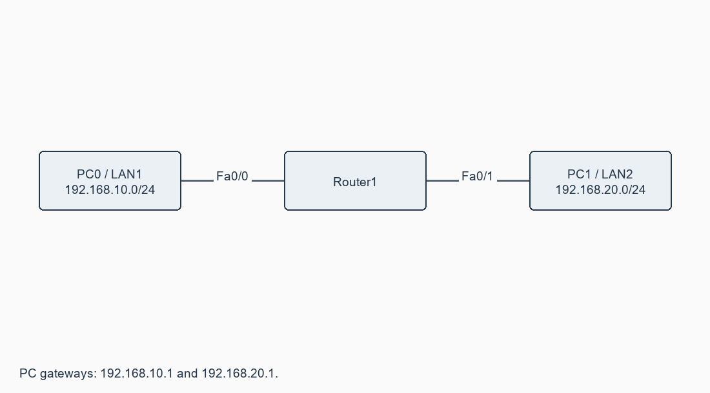

# Exercise 10: Internetworking with routers in CISCO PACKET TRACER simulator

**[Open this exercise record PDF](CN_Exercise_10.pdf)**

## Aim

To configure a simple routed internetwork and a wireless-router/DHCP/cloud network, then reproduce the wired network in the physical lab.

## Requirements

Packet Tracer; router with Fa0/0 and Fa0/1, two switches/host groups; wireless router, laptop, modem, cloud and server.

## Procedure / algorithm

1. Part A: connect LAN 192.168.10.0/24 and LAN 192.168.20.0/24 to Router1 Fa0/0 and Fa0/1 through switches.
2. Apply Router1.cfg; assign PC0 .10.2 and PC1 .20.2 with their local .1 gateway. Expand each side to 3-4 hosts with unique addresses.
3. Send ping/Simple PDU in both directions. Trace router forwarding and reply; directly connected routes are sufficient.
4. Part B: build PC/laptop -> wireless router -> cable modem -> cloud -> Cisco.com server using the specified Ethernet/coaxial connections.
5. Set HomeNetwork, router LAN 192.168.0.1/24, LAN DHCP/DNS and automatic WAN DHCP. Install WPC300N in the powered-off laptop if needed.
6. Configure cloud modules and the Coaxial-to-Ethernet mapping with Cable provider. Configure the server IP, upstream DHCP pool and DNS A record exactly as supplied.
7. Renew PC addresses, inspect ipconfig /all and ping Cisco.com. Save the file.
8. Part C: reproduce Part A with physical switches, router and Ethernet cables; record actual addresses, links and connectivity.

## Complete source / configuration files

### [addressing.csv](addressing.csv)

```text

device,interface,ip,prefix,gateway
Router1,Fa0/0,192.168.10.1,24,none
Router1,Fa0/1,192.168.20.1,24,none
PC0,FastEthernet0,192.168.10.2,24,192.168.10.1
PC1,FastEthernet0,192.168.20.2,24,192.168.20.1

```

### [cloud_dhcp_dns_config.txt](cloud_dhcp_dns_config.txt)

```text

PC -> router Ethernet1: copper straight-through.
Laptop -> router: wireless WPC300N; power off before changing module.
Router Internet -> modem Port1: copper straight-through.
Modem Port0 -> cloud coaxial: coaxial cable.
Cloud Ethernet -> Cisco.com server FastEthernet0: copper straight-through.
Router LAN: 192.168.0.1, mask 255.255.255.0; SSID HomeNetwork.
Router LAN DHCP enabled; starting .100; maximum 50 users; DNS 208.67.220.220.
Router Internet connection: automatic DHCP.
PC and laptop: DHCP; select HomeNetwork on laptop.
Cloud: install PT-CLOUD-NM-1CX and PT-CLOUD-NM-1CFE if absent.
Cloud Config > Cable: Coaxial -> Ethernet; Add. Ethernet provider: Cable.
Server Fa0: 208.67.220.220/24; global gateway 208.67.220.1; DNS 208.67.220.220.
Server DHCP service ON; pool DHCPpool; start 208.67.220.1; /24; users 50.
Server pool gateway 208.67.220.220; DNS 208.67.220.220.
Server DNS service ON; A record Cisco.com -> 208.67.220.220.
Verify: ipconfig /release; ipconfig /renew; ipconfig /all; ping Cisco.com.
This reproduces the manual's isolated Packet Tracer cloud model, not a public Internet deployment.

```

### [Router1.cfg](Router1.cfg)

```text

enable
configure terminal
hostname Router1
interface FastEthernet0/0
 ip address 192.168.10.1 255.255.255.0
 no shutdown
 exit
interface FastEthernet0/1
 ip address 192.168.20.1 255.255.255.0
 no shutdown
 exit
end
copy running-config startup-config

```

## Diagrams





## Actual output / verification

Not executed in the required lab/tool environment. No actual operational output is claimed.

## Expected output

PCs in routed LANs exchange packets. DHCP clients receive 192.168.0.x/24, gateway 192.168.0.1 and DNS 208.67.220.220. Cisco.com resolves and responds at 208.67.220.220.

## Observations

Clients receive LAN settings from the wireless router; its WAN receives separate upstream settings. The server/cloud addresses reproduce the manual's isolated simulation. They are not a production Internet design. No external packet transmission or physical equipment configuration is claimed.

## Result

All three parts have configuration and verification procedures; Packet Tracer and physical-lab execution remain pending.
