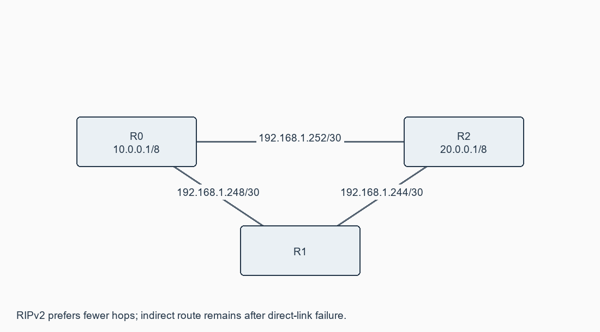
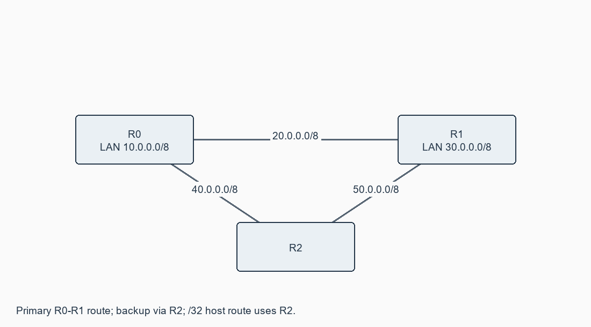

# Exercise 11: Routing at Network Layer

**[Open this exercise record PDF](CN_Exercise_11.pdf)**

## Aim

To simulate static routing and RIP configuration using Cisco Packet Tracer.

## Requirements

Static lab: three 2911 routers and PCs. RIP lab: routers with Fa0/1 and two serial ports, DCE/DTE serial cables.

## Procedure / algorithm

1. Static part: create the triangle in diagrams/static.svg, assign all router/host addresses, and apply static_R0/R1/R2.cfg.
2. On R0, provide AD 10 primary and AD 20 backup routes to 30.0.0.0/8 and 50.0.0.0/8. Provide separate /32 host routes to 30.0.0.100.
3. On R1/R2 configure return/remote routes. Check show ip route static, ping and tracert for a normal LAN host and the /32 host.
4. Disable R0 Gi0/1 to remove the primary path; inspect the backup via R2. Restore the interface afterward.
5. RIP part: create the /30 serial triangle from rip configurations. Fit serial modules while powered off. Match the documented DCE ends; verify using show controllers serial.
6. Set clock rate 64000 on DCE ends, assign interface addresses and enable interfaces. Set endpoint LANs consistently to /8.
7. Enable RIPv2, no auto-summary and networks from rip_R0/R1/R2.cfg. Confirm learned R routes and show ip protocols.
8. Ping/trace PC0 to PC1, disable direct R0-R2 serial link, wait for convergence and verify the R0-R1-R2 path. Restore and recheck.

## Complete source / configuration files

### [rip_hosts.csv](rip_hosts.csv)

```text

device,ip,mask,gateway
PC0,10.0.0.2,255.0.0.0,10.0.0.1
PC1,20.0.0.2,255.0.0.0,20.0.0.1

```

### [rip_R0.cfg](rip_R0.cfg)

```text

enable
configure terminal
hostname R0
interface FastEthernet0/1
 ip address 10.0.0.1 255.0.0.0
 no shutdown
 exit
interface Serial0/0/0
 ip address 192.168.1.249 255.255.255.252
 clock rate 64000
 bandwidth 64
 no shutdown
 exit
interface Serial0/0/1
 ip address 192.168.1.254 255.255.255.252
 clock rate 64000
 bandwidth 64
 no shutdown
 exit
router rip
 version 2
 no auto-summary
 network 10.0.0.0
 network 192.168.1.0
 exit
end
copy running-config startup-config

```

### [rip_R1.cfg](rip_R1.cfg)

```text

enable
configure terminal
hostname R1
interface Serial0/0/0
 ip address 192.168.1.250 255.255.255.252
 no shutdown
 exit
interface Serial0/0/1
 ip address 192.168.1.246 255.255.255.252
 clock rate 64000
 bandwidth 64
 no shutdown
 exit
router rip
 version 2
 no auto-summary
 network 192.168.1.0
 exit
end
copy running-config startup-config

```

### [rip_R2.cfg](rip_R2.cfg)

```text

enable
configure terminal
hostname R2
interface FastEthernet0/1
 ip address 20.0.0.1 255.0.0.0
 no shutdown
 exit
interface Serial0/0/0
 ip address 192.168.1.245 255.255.255.252
 no shutdown
 exit
interface Serial0/0/1
 ip address 192.168.1.253 255.255.255.252
 no shutdown
 exit
router rip
 version 2
 no auto-summary
 network 20.0.0.0
 network 192.168.1.0
 exit
end
copy running-config startup-config

```

### [static_hosts.csv](static_hosts.csv)

```text

device,ip,mask,gateway
PC0,10.0.0.2,255.0.0.0,10.0.0.1
PC1,30.0.0.2,255.0.0.0,30.0.0.1
HostRoutePC,30.0.0.100,255.0.0.0,30.0.0.1

```

### [static_R0.cfg](static_R0.cfg)

```text

enable
configure terminal
hostname R0
interface GigabitEthernet0/0
 ip address 10.0.0.1 255.0.0.0
 no shutdown
 exit
interface GigabitEthernet0/1
 ip address 20.0.0.1 255.0.0.0
 no shutdown
 exit
interface GigabitEthernet0/2
 ip address 40.0.0.1 255.0.0.0
 no shutdown
 exit
ip route 30.0.0.0 255.0.0.0 20.0.0.2 10
ip route 30.0.0.0 255.0.0.0 40.0.0.2 20
ip route 30.0.0.100 255.255.255.255 40.0.0.2 10
ip route 30.0.0.100 255.255.255.255 20.0.0.2 20
ip route 50.0.0.0 255.0.0.0 40.0.0.2 10
ip route 50.0.0.0 255.0.0.0 20.0.0.2 20
end
copy running-config startup-config

```

### [static_R1.cfg](static_R1.cfg)

```text

enable
configure terminal
hostname R1
interface GigabitEthernet0/0
 ip address 30.0.0.1 255.0.0.0
 no shutdown
 exit
interface GigabitEthernet0/1
 ip address 20.0.0.2 255.0.0.0
 no shutdown
 exit
interface GigabitEthernet0/2
 ip address 50.0.0.2 255.0.0.0
 no shutdown
 exit
ip route 10.0.0.0 255.0.0.0 20.0.0.1 10
ip route 10.0.0.0 255.0.0.0 50.0.0.1 20
ip route 40.0.0.0 255.0.0.0 20.0.0.1 10
ip route 40.0.0.0 255.0.0.0 50.0.0.1 20
end
copy running-config startup-config

```

### [static_R2.cfg](static_R2.cfg)

```text

enable
configure terminal
hostname R2
interface GigabitEthernet0/0
 ip address 40.0.0.2 255.0.0.0
 no shutdown
 exit
interface GigabitEthernet0/1
 ip address 50.0.0.1 255.0.0.0
 no shutdown
 exit
ip route 10.0.0.0 255.0.0.0 40.0.0.1
ip route 20.0.0.0 255.0.0.0 40.0.0.1
ip route 30.0.0.0 255.0.0.0 50.0.0.2
end
copy running-config startup-config

```

### [verification_commands.txt](verification_commands.txt)

```text

STATIC:
show ip interface brief
show ip route static
ping 30.0.0.2
tracert 30.0.0.2
tracert 30.0.0.100
Disable R0 Gi0/1, then inspect route and trace again.
RIP:
show controllers serial 0/0/0
show ip protocols
show ip route
ping 20.0.0.2
tracert 20.0.0.2
Disable R0 S0/0/1; wait for convergence and repeat.
Restore each interface with no shutdown.

```

## Diagrams





## Actual output / verification

Not executed in the required lab/tool environment. No actual operational output is claimed.

## Expected output

Static route display shows R0 primary via 20.0.0.2 for 30/8 and via 40.0.0.2 for the /32 host. Backup appears after primary failure. RIP normally uses direct R0-R2 and reroutes through R1 after convergence.

## Observations

Longest-prefix match makes the /32 host route more specific than /8. Lower AD chooses among equivalent prefixes; RIP selects hop count and treats metric 16 as unreachable. Serial DCE clocking and host masks are made consistent where the manual has conflicting examples.

## Result

Complete static/backup/host-route and RIPv2 configurations are supplied. Offline addressing checks pass; router simulation remains pending.
