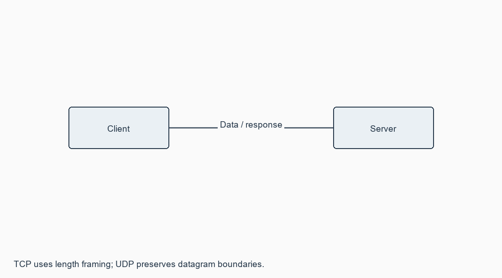

# Exercise 12: End-End Communication at Transport Layer

**[Open this exercise record PDF](CN_Exercise_12.pdf)**

## Aim

To implement echo client/server using TCP/UDP sockets and implement a chat program using socket programming.

## Requirements

Python 3.10+ and two terminals, or the automatic real-socket demo mode.

## Procedure / algorithm

1. Select TCP or UDP and echo or chat. Start server mode before client mode on the same agreed port.
2. TCP: create/bind/listen/accept and connect. Send a four-byte length followed by message bytes; receive exactly the header and payload lengths.
3. UDP: bind server, receive datagrams with the peer address and reply to that peer. The client uses a connected UDP socket for the chosen server.
4. Echo returns the same bytes. Chat is turn-based: client sends text; server reads it and enters a reply. Both peers continue until bye.
5. Run demo mode for all four combinations; it starts a server thread and a real localhost client, exchanges Unicode messages, then closes cleanly.
6. For two physical computers, bind the server to its assigned interface/0.0.0.0 and point the client to the server LAN IP.

## Complete source / configuration files

### [sockets_lab.py](sockets_lab.py)

```python

"""Complete TCP/UDP echo and turn-based chat, with real loopback demos."""
import argparse
import queue
import socket
import struct
import threading


def read_exact(sock, count):
    data = bytearray()
    while len(data) < count:
        part = sock.recv(count - len(data))
        if not part:
            raise EOFError("Peer closed the connection")
        data.extend(part)
    return bytes(data)


def send_tcp(sock, data):
    sock.sendall(struct.pack("!I", len(data)) + data)


def receive_tcp(sock):
    size = struct.unpack("!I", read_exact(sock, 4))[0]
    if size > 1_000_000:
        raise ValueError("Message exceeds the lab limit")
    return read_exact(sock, size)


def response(data, application, automatic):
    text = data.decode("utf-8")
    if application == "echo" or text == "bye":
        return data
    return ("Server received: " + text if automatic
            else input("Server reply: ")).encode("utf-8")


def server(protocol, host, port, application="echo", automatic=False,
           ready=None):
    kind = socket.SOCK_STREAM if protocol == "tcp" else socket.SOCK_DGRAM
    with socket.socket(socket.AF_INET, kind) as sock:
        sock.setsockopt(socket.SOL_SOCKET, socket.SO_REUSEADDR, 1)
        sock.bind((host, port))
        sock.settimeout(10)
        if protocol == "tcp":
            sock.listen(1)
        if ready is not None:
            ready.put(sock.getsockname()[1])
        if protocol == "tcp":
            conn, _ = sock.accept()
            with conn:
                conn.settimeout(10)
                while True:
                    data = receive_tcp(conn)
                    send_tcp(conn, response(data, application, automatic))
                    if data == b"bye":
                        break
        else:
            while True:
                data, peer = sock.recvfrom(65535)
                sock.sendto(response(data, application, automatic), peer)
                if data == b"bye":
                    break


def client(protocol, host, port, messages=None):
    kind = socket.SOCK_STREAM if protocol == "tcp" else socket.SOCK_DGRAM
    replies = []
    with socket.socket(socket.AF_INET, kind) as sock:
        sock.settimeout(5)
        sock.connect((host, port))
        values = iter(messages) if messages is not None else None
        while True:
            text = next(values) if values is not None else input("Client: ")
            data = text.encode("utf-8")
            if protocol == "tcp":
                send_tcp(sock, data)
                reply = receive_tcp(sock)
            else:
                if len(data) > 65507:
                    raise ValueError("UDP message exceeds datagram limit")
                sock.send(data)
                reply = sock.recv(65535)
            replies.append(reply.decode("utf-8"))
            if values is None:
                print("Server:", replies[-1])
            if text == "bye":
                break
    return replies


def demo(protocol, application, messages=None):
    ready, errors = queue.Queue(), queue.Queue()
    def worker():
        try:
            server(protocol, "127.0.0.1", 0, application, True, ready)
        except Exception as error:
            errors.put(error)
    thread = threading.Thread(target=worker, daemon=True)
    thread.start()
    port = ready.get(timeout=5)
    messages = messages or ["Hello CN", "Unicode: cafe \u00e9", "bye"]
    replies = client(protocol, "127.0.0.1", port, messages)
    thread.join(timeout=5)
    if thread.is_alive():
        raise RuntimeError("Server did not close")
    if not errors.empty():
        raise errors.get()
    return replies


def main():
    p = argparse.ArgumentParser(description=__doc__)
    p.add_argument("role", choices=["server", "client", "demo"])
    p.add_argument("--protocol", choices=["tcp", "udp"], default="tcp")
    p.add_argument("--application", choices=["echo", "chat"], default="echo")
    p.add_argument("--host", default="127.0.0.1")
    p.add_argument("--port", type=int, default=5000)
    a = p.parse_args()
    if a.role == "demo":
        print(f"ACTUAL LOCAL SOCKET DEMO: {a.protocol.upper()} {a.application}")
        for value in demo(a.protocol, a.application):
            print("Received:", value)
    elif a.role == "server":
        server(a.protocol, a.host, a.port, a.application)
    else:
        client(a.protocol, a.host, a.port)


if __name__ == "__main__":
    main()

```

## Diagrams



## Run

Commands are from the repository root unless a cd command is shown.

```text

python Exercise_12/sockets_lab.py demo --protocol tcp --application echo
python Exercise_12/sockets_lab.py demo --protocol udp --application echo
python Exercise_12/sockets_lab.py demo --protocol tcp --application chat
python Exercise_12/sockets_lab.py demo --protocol udp --application chat
python Exercise_12/sockets_lab.py server --protocol tcp --application chat --port 5002
python Exercise_12/sockets_lab.py client --protocol tcp --application chat --port 5002

```

## Actual output / verification

```text

ACTUAL LOCAL SOCKET DEMO: TCP echo
Received: Hello CN
Received: Unicode: cafe é
Received: bye

ACTUAL LOCAL SOCKET DEMO: TCP chat
Received: Server received: Hello CN
Received: Server received: Unicode: cafe é
Received: bye

ACTUAL LOCAL SOCKET DEMO: UDP echo
Received: Hello CN
Received: Unicode: cafe é
Received: bye

ACTUAL LOCAL SOCKET DEMO: UDP chat
Received: Server received: Hello CN
Received: Server received: Unicode: cafe é
Received: bye

```

## Expected output

Echo returns the input unchanged. Interactive chat displays the server's typed reply. Sending bye returns bye and closes the session.

## Observations

Actual TCP/UDP echo and chat demos ran on loopback. TCP tests included a 70,000-character message to verify handling beyond a recv buffer. UDP preserves datagram boundaries; it has no reliability/order guarantee. No two-computer deployment is claimed.

## Result

TCP/UDP echo and turn-based chat were executed and verified using real local sockets.
