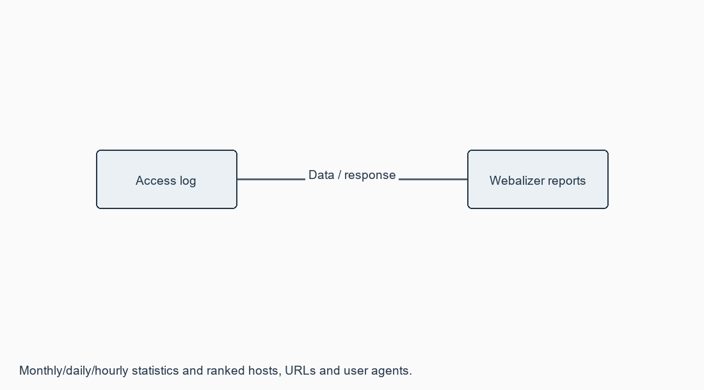

# Exercise 15: Analyse various types of servers using Webalizer tool

**[Open this exercise record PDF](CN_Exercise_15.pdf)**

## Aim

To analyse different types of web logs using Webalizer.

## Requirements

Webalizer Windows GUI or CLI; compatible web access log; supplied configuration and synthetic combined-log fixture.

## Procedure / algorithm

1. Start the Windows Webalizer application as in the manual; input a compatible access-log file and press Run Webalizer.
2. For CLI, create reports directory and run webalizer -c webalizer.conf from this experiment directory. run.ps1 checks the executable before doing so.
3. Inspect monthly, daily and hourly statistics; distinguish hits, files, pages, visits, hosts and transferred bytes.
4. Inspect URLs, entry/exit pages, ranked Hosts and User-agents. Combined logs supply referrer and agent information.
5. Report actual peak periods and resources from the log. Do not equate IP hosts with unique people or hits with page views.
6. For the supplied synthetic five-line fixture, compare the deterministic raw-log counts with the expected report totals.

## Complete source / configuration files

### [run.ps1](run.ps1)

```text

Set-Location $PSScriptRoot
if (-not (Get-Command webalizer -ErrorAction SilentlyContinue)) {
    throw 'Install Webalizer or use the lab Windows GUI; no Webalizer run is claimed.'
}
New-Item -ItemType Directory -Force reports | Out-Null
webalizer -c webalizer.conf
if ($LASTEXITCODE -ne 0) { throw 'Webalizer failed.' }

```

### [webalizer.conf](webalizer.conf)

```text

LogFile data/access.log
LogType clf
OutputDir reports
HostName CN-Lab-Demo
Incremental no
DNSChildren 0
PageType html
PageType htm
VisitTimeout 1800

```

### [data/access.log](data/access.log)

```text

198.51.100.10 - - [13/Oct/2026:10:00:00 +0530] "GET /index.html HTTP/1.1" 200 1000 "-" "CN-Demo-Browser/1.0"
198.51.100.10 - - [13/Oct/2026:10:00:01 +0530] "GET /style.css HTTP/1.1" 200 200 "http://cn-lab/index.html" "CN-Demo-Browser/1.0"
198.51.100.10 - - [13/Oct/2026:10:01:00 +0530] "GET /about.html HTTP/1.1" 200 1500 "http://cn-lab/index.html" "CN-Demo-Browser/1.0"
198.51.100.20 - - [13/Oct/2026:10:02:00 +0530] "GET /logo.png HTTP/1.1" 200 300 "-" "CN-Demo-Crawler/1.0"
198.51.100.20 - - [13/Oct/2026:10:02:01 +0530] "GET /index.html HTTP/1.1" 200 1000 "-" "CN-Demo-Crawler/1.0"

```

## Diagrams



## Run

Commands are from the repository root unless a cd command is shown.

```text

cd Exercise_15
mkdir reports
webalizer -c webalizer.conf

```

## Actual output / verification

Not executed in the required lab/tool environment. No actual operational output is claimed.

## Actual synthetic-fixture check

```text

ACTUAL FIXTURE CHECK - NOT WEBALIZER OUTPUT
5 log records; 2 client IPs; 3 HTML requests; 4,000 response bytes.
Webalizer executable was not available; report generation not run.

```

## Expected output

For the supplied fixture: 5 hits, 5 successful file requests, 3 HTML page requests, 2 client IPs and 4,000 response bytes. Session/visit and user-agent tables depend on the configured Webalizer rules/version.

## Observations

Webalizer is not installed, so no actual Webalizer HTML/chart output is claimed. The synthetic log has reserved documentation IPs and artificial agent names. An independent fixture check verifies five lines, two IPs and 4,000 response bytes; it is not a Webalizer run.

## Result

A complete Webalizer configuration, sample input log and report interpretation are supplied; Webalizer execution remains pending.
